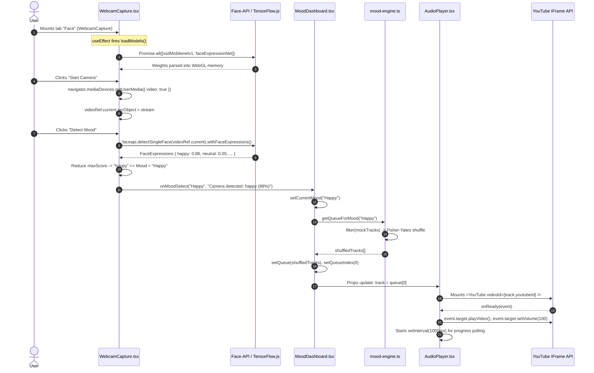

# Comprehensive Codebase Audit & Senior Technical Interview Preparation Guide
**Project:** Mood Music Web App (`MoodTunes`)  
**Repository:** `Vansh-06-03-06/Mood-Music-Web-App`  
**Role Target:** Frontend Engineer / Fullstack Engineer / AI-Web Integration Specialist  
**Auditor:** Staff Software Engineer & Senior Technical Interviewer  

---

## Executive Summary

The **Mood Music Web App** is an edge-computed, emotion-driven music streaming web application built with **Next.js 14 (App Router)**, **React 18**, **TypeScript**, and **Tailwind CSS**. It bridges client-side Machine Learning (**TensorFlow.js** via `@vladmandic/face-api`) and custom headless media orchestration (**react-youtube**) to detect emotional states (via Facial Expression Analysis, Natural Language Keyword Heuristics, or Manual Archetype Selection) and dynamically deliver curated audio playlists.

This audit provides:
1. **Architectural Map & End-to-End Codeflows**: Deep system interaction diagrams and runtime tracing.
2. **Code Quality, Strengths & Latent Vulnerabilities**: Architectural wins alongside critical memory leaks, unhandled async states, browser hardware lifecycle oversights, and model payload bottlenecks.
3. **Probable Interview Questions & Technical Grilling**: A categorized question bank spanning system design, concurrency, DOM performance, and hardware edge cases.
4. **Ideal Candidate Answers (Cheat Sheet)**: Senior-level, code-specific answers with exact file and line references designed to defend this project against rigorous technical vetting.

---

# 1. Architectural Map & Codeflow

```
+-------------------------------------------------------------------------------------------------------+
|                                           CLIENT BROWSER                                              |
|                                                                                                       |
|  +-------------------------------------------------------------------------------------------------+  |
|  |                                  Root Layout (app/layout.tsx)                                   |  |
|  |                                 Dark Mode Shell, Geist/Inter Font                               |  |
|  +-------------------------------------------------------------------------------------------------+  |
|                                                   |                                                   |
|                                                   v                                                   |
|  +-------------------------------------------------------------------------------------------------+  |
|  |                                  Page Container (app/page.tsx)                                  |  |
|  |                                   Mounts <MoodDashboard />                                      |  |
|  +-------------------------------------------------------------------------------------------------+  |
|                                                   |                                                   |
|                                                   v                                                   |
|  +-------------------------------------------------------------------------------------------------+  |
|  |                            Orchestration Hub (components/MoodDashboard.tsx)                     |  |
|  |  State: currentMood, queue, queueIndex, activeTab ('Text' | 'Face' | 'Moods'), reason           |  |
|  +-------------------------------------------------------------------------------------------------+  |
|         |                                    |                                    |                   |
|         v                                    v                                    v                   |
|  +--------------------+             +--------------------+             +--------------------+         |
|  |  TextMoodInput.tsx  |             | WebcamCapture.tsx  |             | ManualSelector.tsx |         |
|  |  Keyword matching  |             | Client-side Vision |             | 6-Mood Preset Grid |         |
|  |  heuristic engine  |             | Face-API / TFJS    |             | Instant Dispatch   |         |
|  +--------------------+             +--------------------+             +--------------------+         |
|         \                                    |                                   /                    |
|          -----------------------------> [onMoodSelect] <-------------------------                     |
|                                              |                                                        |
|                                              v                                                        |
|                                 +--------------------------+                                          |
|                                 | mood-engine:             |                                          |
|                                 | getQueueForMood(mood)    |                                          |
|                                 | Fisher-Yates Shuffle     |                                          |
|                                 +--------------------------+                                          |
|                                              |                                                        |
|                       +----------------------+----------------------+                                 |
|                       |                                             |                                 |
|                       v                                             v                                 |
|         +---------------------------+                 +---------------------------+                   |
|         |  AmbientBackground.tsx    |                 |     AudioPlayer.tsx       |                   |
|         |  - Framer Motion glow     |                 |  - Offscreen YouTube iFrame|                  |
|         |  - Client-side particle   |                 |  - Custom Player Controls  |                  |
|         |    hydration-safe notes   |                 |  - 1000ms Polling Hook     |                  |
|         +---------------------------+                 +---------------------------+                   |
+-------------------------------------------------------------------------------------------------------+
                                                  | (Static Model Fetch: /models/*.bin)
                                                  v
+-------------------------------------------------------------------------------------------------------+
|                              EDGE STATIC STORAGE / NGINX DOCKER CONTAINER                             |
|  - Next.js Static Export (`out/`) served via Nginx Alpine on Port 80                                  |
|  - Pre-trained TensorFlow weights (`ssd_mobilenetv1`, `face_expression_model`)                        |
+-------------------------------------------------------------------------------------------------------+
```

---

## 1.1 High-Level Component Interactions

1. **Static Shell (`next.config.mjs` & `Dockerfile`)**:
   - The application is configured with `output: 'export'`, compiling to pure static HTML/JS/CSS assets.
   - Built via a multi-stage Dockerfile (`node:20-alpine` -> `nginx:alpine`), making it zero-runtime-server dependent. It runs fully client-side once delivered to the browser.
2. **State Orchestrator (`MoodDashboard.tsx`)**:
   - Acts as the Single Source of Truth (SSOT).
   - Manages top-level state: `currentMood` (`Mood | null`), `queue` (`Track[]`), `queueIndex` (`number`), `activeTab` (`Tab`), and `reason` (`string`).
   - Uses `next/dynamic` with `{ ssr: false }` for `WebcamCapture` to completely avoid server-side hydration crashes resulting from references to `window`, `navigator`, or WebGL contexts.
3. **Mood Ingestion Pipelines**:
   - **Visual Stream (`WebcamCapture.tsx`)**: Directly interfaces with hardware via `navigator.mediaDevices.getUserMedia`, renders into a flipped `<video>` element, and passes frames to `@vladmandic/face-api` (TensorFlow.js backend).
   - **Text Semantic Stream (`TextMoodInput.tsx`)**: Evaluates free-form text input against regex/substring lexicon mappings in `mood-engine.ts`.
   - **Direct Selection (`ManualSelector.tsx`)**: Immediate dispatch from predefined mood enums.
4. **Queue Generation Engine (`mood-engine.ts` & `mock-database.ts`)**:
   - Takes a `Mood` enum, filters the 36-track database, executes an in-place Fisher-Yates array permutation, and resets the playlist index to 0.
5. **Headless Audio Execution (`AudioPlayer.tsx`)**:
   - Bypasses standard YouTube video rendering by positioning the iframe offscreen (`-left-[9999px] -top-[9999px] opacity-0 pointer-events-none`).
   - Translates YouTube player lifecycle events (`onReady`, `onStateChange`, `onError`) into React state, driving custom play/pause, volume sliders, track scrubbing, and skip mechanics.
6. **Reactive Environment Canvas (`AmbientBackground.tsx`)**:
   - Uses `framer-motion` to interpolate background ambient hue according to `MOOD_COLORS` and orchestrates 45 randomized floating music notes with deterministic client-side hydration generation.

---

## 1.2 End-to-End Runtime Execution Tracing

### Primary Flow A: Facial Emotion Recognition & Autonomous Playback



---

# 2. Code Quality, Strengths & Vulnerabilities

## 2.1 Architectural Wins & Well-Implemented Patterns

### 1. Isolated Headless IFrame Architecture
- **Location:** `src/components/AudioPlayer.tsx` (Lines 171–173)
- **Pattern:** Headless Player / Proxy Adapter.
- **Why it's strong:** Instead of relying on YouTube's intrusive video player UI with branding, ads, annotations, and recommendations, the app wraps the YouTube IFrame API into an invisible headless audio engine. It intercepts `onReady`, `onStateChange`, and player instance methods (`seekTo`, `playVideo`, `pauseVideo`, `setVolume`) to power a custom, responsive, glassmorphic UI.

### 2. Client-Side Edge AI Inference (Privacy & Cost Advantage)
- **Location:** `src/components/inputs/WebcamCapture.tsx` (Lines 14–27, 63–66)
- **Pattern:** Edge AI / Zero-Data-Ingress Architecture.
- **Why it's strong:** No video frames, biometrics, or camera streams are sent across the network. All computer vision tensor computations occur in-memory within the client's browser (WebGL/WASM). This provides **100% GDPR/BIPA biometric compliance by design** and scales to infinite users at **$0 cloud GPU/inference cost**.

### 3. Dynamic SSR Isolation for Browser-Only Hardware APIS
- **Location:** `src/components/MoodDashboard.tsx` (Line 12)
- **Pattern:** Dynamic Module Splitting with SSR Dehydration.
- **Why it's strong:** The webcam and TensorFlow models depend on DOM-only primitives (`navigator.mediaDevices`, `HTMLVideoElement`, `canvas`, WebGL context). By declaring `const WebcamCapture = dynamic(() => import('./inputs/WebcamCapture'), { ssr: false })`, the codebase prevents Node.js server-side evaluation crashes during build/SSG export while keeping initial bundle sizes lean.

### 4. Hydration-Safe Particle Randomization
- **Location:** `src/components/AmbientBackground.tsx` (Lines 14–25)
- **Pattern:** Two-Pass Deterministic Hydration.
- **Why it's strong:** Generating random positions (`Math.random()`) during server render or initial client component definition causes React Error #418 / Hydration Mismatch. By generating the 45 floating notes inside `useEffect`, the initial server and client render tree are identical (`elements = []`), and animations mount cleanly post-hydration.

### 5. Mathematically Unbiased Shuffle (Fisher-Yates)
- **Location:** `src/lib/mood-engine.ts` (Lines 9–16)
- **Pattern:** Knuth / Fisher-Yates Uniform Permutation.
- **Why it's strong:** Many junior codebases use `array.sort(() => Math.random() - 0.5)`, which introduces severe non-uniform distribution bias (due to V8's Timsort algorithm). This codebase implements an in-place $O(N)$ swap loop on an isolated shallow copy.

---

## 2.2 Deep Vulnerabilities, Bottlenecks & Code Smells

### 🔴 Critical 1: Severe Hardware Memory Leak (Camera Stream Orphaned on Tab Switch)
- **File:** `src/components/inputs/WebcamCapture.tsx` & `src/components/MoodDashboard.tsx`
- **Issue:** In `MoodDashboard.tsx` (Lines 98–116), tab switching causes conditional rendering (`activeTab === 'Face' && <WebcamCapture />`). If a user turns on the camera and switches tabs to "Text" or "Moods", the `WebcamCapture` component unmounts. However, `WebcamCapture.tsx` **has no `useEffect` cleanup return function** to stop the active `MediaStreamTrack`s.
- **Impact:** The user's webcam hardware light stays ON indefinitely. Memory and CPU consumption continue in the browser process, presenting a critical security/privacy red flag.
- **Code Audit:**
  ```typescript
  // IN WebcamCapture.tsx:
  // stopCamera exists at line 41, but is NEVER called on component unmount:
  useEffect(() => {
    return () => {
      // MISSING: stream cleanup
    };
  }, []);
  ```
- **Remediation:**
  ```typescript
  useEffect(() => {
    return () => {
      if (videoRef.current && videoRef.current.srcObject) {
        const stream = videoRef.current.srcObject as MediaStream;
        stream.getTracks().forEach((track) => track.stop());
      }
    };
  }, []);
  ```

### 🔴 Critical 2: Browser Autoplay Policy Race Condition (`NotAllowedError`)
- **File:** `src/components/AudioPlayer.tsx` (Lines 72–76)
- **Issue:** When the YouTube player fires `onReady`, it executes `event.target.playVideo()`. Modern browsers (Safari, Chrome, Firefox) enforce strict **Autoplay Policies**: media with audio cannot play automatically unless triggered by a synchronous, direct user activation gesture (like a click). 
- **Impact:** In the webcam detection workflow, `onMoodSelect` is triggered asynchronously after `await faceapi.detectSingleFace()`. Because this execution is detached from the user's initial click event tick, browsers block `playVideo()`, causing audio to fail silently or throw `NotAllowedError`.
- **Remediation:** Catch playback rejections, initialize the player in a muted state or display a visible "Click to Play" overlay if browser autoplay fails.

### 🟡 High 3: Aggressive Model Weight Payload Bottleneck (5.6 MB SSD MobileNet vs 190 KB TinyFace)
- **File:** `src/components/inputs/WebcamCapture.tsx` (Lines 18–19, 56–61)
- **Issue:** The component loads `faceapi.nets.ssdMobilenetv1.loadFromUri('/models')`. Checking `public/models`:
  - `ssd_mobilenetv1_model.bin` is **5.61 MB**.
  - `tiny_face_detector_model.bin` is **193 KB** (29x smaller!).
- **Impact:** Over 3G/4G or throttled networks, the app stalls on initial camera startup, downloading over 6 MB of binary weights before face detection can occur.
- **Remediation:** Migrate from SSD MobileNet v1 to `tinyFaceDetector`, which is already present in `public/models`:
  ```typescript
  await faceapi.nets.tinyFaceDetector.loadFromUri('/models');
  // and run detection with:
  new faceapi.TinyFaceDetectorOptions({ inputSize: 224, scoreThreshold: 0.5 })
  ```

### 🟡 High 4: Inactive Tab IFrame Throttling & Offscreen Positioning
- **File:** `src/components/AudioPlayer.tsx` (Lines 171–173)
- **Issue:** The player is placed at `fixed -left-[9999px] -top-[9999px] opacity-0 pointer-events-none`.
- **Impact:** Chromium and WebKit power-saving optimizations detect that the iframe has an intersection ratio of 0 and zero visual visibility. When the user minimizes the window or switches tabs, the browser deprioritizes or freezes the iframe's JavaScript timer loops, causing audio playback to stutter or stop completely.
- **Remediation:** Render the iframe with dimensions `1px x 1px`, `opacity: 0.01`, positioned within the viewport bounds (e.g. `bottom-0 right-0 z-0`), or enable standard YouTube audio stream proxying.

### 🟡 Medium 5: Unbounded Cascading Error Loop on Restricted YouTube Embeds
- **File:** `src/components/AudioPlayer.tsx` (Lines 87–90)
- **Issue:**
  ```typescript
  const onError = (event: YouTubeEvent) => {
    console.error("YouTube Player Error code:", event.data);
    onSkip(); 
  };
  ```
  If a track fails with YouTube Error 101 or 150 (the copyright owner disabled embedded playback) or Error 100 (video removed), `onError` immediately triggers `onSkip()`. If several songs in a mood playlist have embedding restrictions, `onSkip()` recursively advances through the playlist within milliseconds, creating an infinite render loop and exceeding YouTube API rate limits.
- **Remediation:** Implement an error counter or circuit breaker: abort after 3 consecutive failures and alert the user.

### 🟢 Low 6: Naive Keyword Substring Collision in `analyzeTextToMood`
- **File:** `src/lib/mood-engine.ts` (Lines 19–30)
- **Issue:** Uses simple substring inclusion:
  ```typescript
  if (lower.includes('happy') || lower.includes('joy') || lower.includes('great')) return 'Happy';
  if (lower.includes('stress') || lower.includes('anx') || lower.includes('exam') || lower.includes('overwhelm')) return 'Stressed';
  ```
  - Inputting `"I am NOT happy"` matches `lower.includes('happy')` and returns **Happy**.
  - Words containing `"anx"` like `"unanxious"` return **Stressed**.
- **Remediation:** Use tokenized regex with word boundaries `\b(happy|joy)\b` and check for preceding negation tokens (`not`, `never`, `don't`).

---

# 3. Probable Interview Questions & Technical Grilling

## Category 1: Architecture & System Design Choices
1. **Q1.1:** Why choose Next.js 14 App Router with static HTML export (`output: 'export'`) over a traditional Express + React SPA or full SSR?
2. **Q1.2:** What are the architectural trade-offs of embedding a hidden YouTube IFrame vs. using the Spotify Web Playback SDK or native HTML5 `<audio>` tags with S3/CDN-hosted MP3s?
3. **Q1.3:** Explain the Docker deployment strategy used in this project. Why use a multi-stage Dockerfile containing Node.js and Nginx?

## Category 2: Deep Technical & Implementation Logic
4. **Q2.1:** Walk through the complete lifecycle of `@vladmandic/face-api` model initialization, tensor inference, and memory management inside `WebcamCapture.tsx`.
5. **Q2.2:** Explain why `next/dynamic` with `{ ssr: false }` was necessary for `WebcamCapture`, and what would happen at build time (`next build`) without it.
6. **Q2.3:** In `mood-engine.ts`, why is the Fisher-Yates shuffle algorithm used instead of `array.sort(() => Math.random() - 0.5)`? What is the mathematical and Big-O difference?
7. **Q2.4:** In `AmbientBackground.tsx`, why was `useState` + `useEffect` used to generate the floating musical notes instead of initializing them directly in component state or rendering them statically?

## Category 3: Concurrency, React Lifecycles & Performance
8. **Q3.1:** In `AudioPlayer.tsx`, you have a 1000ms `setInterval` polling `player.getCurrentTime()`. What are the performance implications of polling vs. event-driven progress? Can this cause state tearing or memory leaks?
9. **Q3.2:** What happens if a user navigates between the "Face", "Text", and "Moods" tabs rapidly while the webcam stream is initializing? How does React 18 reconciliation handle this?
10. **Q3.3:** How do browser Autoplay Policies impact `AudioPlayer.tsx`, and why might audio fail to start after facial detection?

## Category 4: Edge Cases, Failure Modes & Hardening
11. **Q4.1:** What happens when YouTube returns Error Code 150 or 101 (Embedding disabled by copyright owner)? How does the player respond?
12. **Q4.2:** In `WebcamCapture.tsx`, how are camera permission denials (`NotAllowedError` / `NotFoundError`) handled when the user clicks "Start Camera"?
13. **Q4.3:** If you scale this application to 100,000 active concurrent users, where will the system break first?

---

# 4. Ideal Candidate Answers (Cheat Sheet)

Use the following responses to defend the codebase during technical interviews.

---

### Q1.1: Why choose Next.js 14 App Router with static HTML export (`output: 'export'`) over a traditional Express + React SPA or full SSR?
> **Candidate Answer:**  
> "In [`next.config.mjs`](file:///c:/Users/KAJAL/VANSH/Mood%20Music%20Project/next.config.mjs#L3), I configured `output: 'export'`, compiling the entire application into static HTML, CSS, and client-side JavaScript bundles (`/out`).
> 
> Here was my architectural reasoning:
> 1. **Zero-Server Infrastructure & Edge Distribution:** The entire app—including the AI inference engine and media playback—runs strictly client-side. There are no proprietary backend database queries or server-side dynamic sessions needed. Serving static assets through Nginx or an Edge CDN (like Cloudflare or Vercel Edge) gives us near-zero TTFB (Time to First Byte), horizontal scalability to millions of users, and negligible hosting costs.
> 2. **Build-Time Optimization:** Next.js provides automatic asset minification, CSS purging with Tailwind, and font preloading via `next/font/google` (`app/layout.tsx` lines 5–9) which eliminates layout shifts (CLS).
> 3. **Extensibility:** If we later introduce server-side user authentication or a relational database for playlist history, the Next.js App Router allows us to convert specific routes into Server Components or Edge API routes without restructuring the codebase."

---

### Q1.2: What are the architectural trade-offs of embedding a hidden YouTube IFrame vs. using Spotify Web Playback SDK or native HTML5 `<audio>`?
> **Candidate Answer:**  
> "In [`AudioPlayer.tsx`](file:///c:/Users/KAJAL/VANSH/Mood%20Music%20Project/src/components/AudioPlayer.tsx#L171-L173), I implemented a headless proxy over the YouTube IFrame API.
> 
> Here is the trade-off matrix:
> 
> | Solution | Licensing / Catalog | UX Control | Technical Bottlenecks |
> | :--- | :--- | :--- | :--- |
> | **YouTube IFrame (Chosen)** | Massive zero-cost library, includes indie remixes & lo-fi streams. | Requires headless CSS hiding tricks; constrained by iFrame messaging. | Browser autoplay restrictions, iframe background throttling, copyright embedding blocks (error 150). |
> | **Spotify SDK** | High audio fidelity, rich metadata API. | Strict Premium subscription requirement (`OAuth` token needed for every listener). | High user friction (login wall); cannot play music for anonymous users. |
> | **Native `<audio>` + S3/CDN** | Absolute control over Web Audio API, frequency analysis, and DSP. | Highest infrastructure cost; severe copyright liability for commercial songs. | Must manage storage, bandwidth, CDN egress costs, and music rights. |
> 
> For an accessible MVP, YouTube was the optimal choice because it allows immediate, friction-free music playback without a paywall or login barrier."

---

### Q1.3: Explain the Docker deployment strategy used in this project. Why use a multi-stage Dockerfile containing Node.js and Nginx?
> **Candidate Answer:**  
> "In [`Dockerfile`](file:///c:/Users/KAJAL/VANSH/Mood%20Music%20Project/Dockerfile#L1-L27), I implemented a multi-stage build pattern:
> 1. **Builder Stage (`node:20-alpine`):** Copies package specifications, runs `npm ci` for deterministic dependency resolution, and executes `npm run build`. This generates the optimized static production export in the `/app/out` directory.
> 2. **Runner Stage (`nginx:alpine`):** We discard the entire Node.js runtime, `node_modules`, npm caches, and build tools. We copy only the `/app/out` folder into `/usr/share/nginx/html`.
> 
> **Key Benefits:**
> - **Attack Surface Reduction:** Zero Node.js vulnerabilities exist in production; the container has no active runtime shell interpreter or open Node ports.
> - **Container Footprint:** The final image size drops from ~1.2 GB (with `node_modules` and OS toolchains) to ~25 MB with Nginx Alpine.
> - **High-Performance Static Serving:** Nginx handles HTTP connection pooling, gzip/brotli compression, and static asset caching much more efficiently than `next start` or an Express static server."

---

### Q2.1: Walk through the complete lifecycle of `@vladmandic/face-api` model initialization, tensor inference, and memory management inside `WebcamCapture.tsx`.
> **Candidate Answer:**  
> "The pipeline in [`WebcamCapture.tsx`](file:///c:/Users/KAJAL/VANSH/Mood%20Music%20Project/src/components/inputs/WebcamCapture.tsx#L14-L104) executes in four distinct phases:
> 
> 1. **Model Ingestion (`useEffect`, lines 14–27):**  
>    `faceapi.nets.ssdMobilenetv1.loadFromUri('/models')` and `faceapi.nets.faceExpressionNet.loadFromUri('/models')` fetch manifest JSON files and binary tensor weight shards via HTTP GET from the `/public/models` directory. These weights are parsed and transferred directly into GPU texture memory using TensorFlow.js's WebGL backend.
> 2. **Hardware Video Binding (`startCamera`, lines 29–39):**  
>    Calls `navigator.mediaDevices.getUserMedia({ video: true })` to request camera hardware access. The returned `MediaStream` is assigned to `videoRef.current.srcObject`.
> 3. **Frame Sampling & Forward Pass (`captureAndDetect`, lines 51–66):**  
>    When the user triggers detection, `faceapi.detectSingleFace` extracts the current HTMLVideoElement raster frame, converts it into an internal input tensor, normalizes pixel luminance, and passes it through the SSD MobileNet backbone to extract the facial bounding box.
> 4. **Expression Classification (`withFaceExpressions`, lines 66–80):**  
>    The cropped face bounding box is fed to `FaceExpressionNet`, which computes softmax probability distributions across 7 archetypes: `neutral`, `happy`, `sad`, `angry`, `fearful`, `disgusted`, `surprised`. We reduce these probabilities using `Object.entries(expressions).reduce` to find the `maxScore` and map the dominant expression to our project's `Mood` domain."

---

### Q2.2: Why was `next/dynamic` with `{ ssr: false }` necessary for `WebcamCapture`?
> **Candidate Answer:**  
> "In [`MoodDashboard.tsx`](file:///c:/Users/KAJAL/VANSH/Mood%20Music%20Project/src/components/MoodDashboard.tsx#L12):
> ```typescript
> const WebcamCapture = dynamic(() => import('./inputs/WebcamCapture'), { ssr: false });
> ```
> 
> Next.js pre-renders components during the build step (`next build`) or on the server. However:
> 1. `@vladmandic/face-api` immediately references browser-only globals on import—specifically `window`, `document`, `HTMLVideoElement`, `navigator.userAgent`, and the WebGL canvas context.
> 2. In a server environment (Node.js), these globals are `undefined`. If Next.js attempts to evaluate `WebcamCapture` on the server, it throws a fatal `ReferenceError: window is not defined` or fails to initialize WebGL shaders.
> 3. Setting `{ ssr: false }` instructs Next.js to omit `WebcamCapture` during server/static pre-rendering and only fetch and hydrate the chunk once execution reaches the client browser."

---

### Q2.3: In `mood-engine.ts`, why is the Fisher-Yates shuffle algorithm used instead of `array.sort(() => Math.random() - 0.5)`?
> **Candidate Answer:**  
> "In [`mood-engine.ts`](file:///c:/Users/KAJAL/VANSH/Mood%20Music%20Project/src/lib/mood-engine.ts#L9-L16), I implemented an in-place Fisher-Yates shuffle:
> ```typescript
> const shuffled = [...matchingTracks];
> for (let i = shuffled.length - 1; i > 0; i--) {
>   const j = Math.floor(Math.random() * (i + 1));
>   [shuffled[i], shuffled[j]] = [shuffled[j], shuffled[i]];
> }
> ```
> 
> **Why `sort(() => Math.random() - 0.5)` is fundamentally flawed:**
> 1. **Non-Uniform Probability Distribution:** Sorting algorithms (like V8's Timsort) compare element pairs based on transitivity assumptions ($A > B$ and $B > C \implies A > C$). Because `Math.random() - 0.5` violates transitivity, certain permutations have a significantly higher probability of appearing than others.
> 2. **Algorithmic Complexity:** `array.sort()` runs in $O(N \log N)$ comparison operations.
> 
> **Fisher-Yates Advantage:**
> - Runs strictly in $O(N)$ linear time.
> - Guarantees an unbiased, mathematically uniform distribution where every single permutation of tracks has an exact probability of $1 / N!$."

---

### Q2.4: In `AmbientBackground.tsx`, why was `useState` + `useEffect` used to generate the floating musical notes instead of initializing them directly in component state or rendering them statically?
> **Candidate Answer:**  
> "In [`AmbientBackground.tsx`](file:///c:/Users/KAJAL/VANSH/Mood%20Music%20Project/src/components/AmbientBackground.tsx#L12-L25), note generation is deferred to `useEffect`:
> 
> ```typescript
> const [elements, setElements] = useState<...>([]);
> useEffect(() => {
>   const arr = Array.from({ length: 45 }).map((_, i) => ({
>     id: i,
>     left: `${Math.random() * 100}%`,
>     delay: Math.random() * 10,
>     ...
>   }));
>   setElements(arr);
> }, []);
> ```
> 
> **Hydration Mismatch Prevention:**
> If we generated `Math.random()` values during initial render, the server-generated HTML (or initial SSR markup) would calculate one set of numbers (e.g. `left: 23%`), while the client during hydration would calculate a different set (e.g. `left: 87%`). 
> This difference triggers React Hydration Error #418 / #423, forcing React to discard the pre-rendered DOM and reconstruct it.
> 
> By initializing state to an empty array `[]` and populating it inside `useEffect`, the initial render matches perfectly between server and client. The notes are then generated deterministically on the client once mounted."

---

### Q3.1: In `AudioPlayer.tsx`, you have a 1000ms `setInterval` polling `player.getCurrentTime()`. What are the performance implications of polling vs. event-driven progress? Can this cause state tearing or memory leaks?
> **Candidate Answer:**  
> "In [`AudioPlayer.tsx`](file:///c:/Users/KAJAL/VANSH/Mood%20Music%20Project/src/components/AudioPlayer.tsx#L22-L38):
> 
> 1. **Why Polling is Used:** The YouTube IFrame API does not provide a continuous high-frequency time-update event like the native HTML5 `<audio ontimeupdate>` event. It only emits coarse discrete state changes (`PLAYING`, `PAUSED`, `ENDED`). Polling via `setInterval` is therefore necessary to update the progress bar.
> 2. **Performance Impact:** 
>    - Because `player.getCurrentTime()` returns a Promise (or an asynchronous postMessage bridge across iframes), calling it every 1000ms triggers asynchronous messaging and subsequent React state updates (`setProgress`, `setCurrentTimeStr`), causing `AudioPlayer` to re-render every second.
> 3. **Safeguards Against Memory Leaks & Tearing:**
>    - The cleanup return function `return () => clearInterval(interval);` ensures that when `isPlaying` becomes `false` or the player unmounts, the timer is cleared immediately.
>    - To optimize this further in a production rewrite, I would decouple the scrubber UI by updating a CSS custom property or canvas directly via `requestAnimationFrame`, isolating time progression from React's core virtual DOM reconciliation cycle."

---

### Q3.2: What happens if a user navigates between the "Face", "Text", and "Moods" tabs rapidly while the webcam stream is initializing?
> **Candidate Answer:**  
> "In the current implementation, this exposes an **asynchronous race condition and hardware leak**:
> 1. If the user clicks 'Face', `startCamera()` is called (`navigator.mediaDevices.getUserMedia`).
> 2. Before the browser hardware finishes initializing or the user clicks 'Allow', the user switches to 'Text'.
> 3. `MoodDashboard.tsx` conditionally unmounts `WebcamCapture`.
> 4. When the camera promise resolves, `videoRef.current` is now `null` (since the element was unmounted). The stream is either assigned to a detached node or left dangling in browser memory.
> 
> **How to Defend and Fix It:**  
> 'To solve this, I would introduce an `AbortController` or a cancellation flag inside `useEffect`. If the component unmounts before the stream or model promises settle, the callback catches the abort state, calls `stream.getTracks().forEach(track => track.stop())`, and prevents calling `setState` on an unmounted component.'"

---

### Q3.3: How do browser Autoplay Policies impact `AudioPlayer.tsx`, and why might audio fail to start after facial detection?
> **Candidate Answer:**  
> "Browsers enforce the **Muted Autoplay Policy** to prevent unwanted audio: media can only play with sound if initiated by a trusted user gesture (a direct click or tap event tick).
> 
> 1. In `ManualSelector.tsx`, the user directly clicks a button $\rightarrow$ this click gesture cascades down to play audio synchronously, which browsers allow.
> 2. In `WebcamCapture.tsx`, the user clicks 'Detect Mood', but playback is triggered **after** an asynchronous chain (`await faceapi.detectSingleFace(...)`). By the time `onMoodSelect` fires and reaches `player.playVideo()`, the browser's user-gesture token has expired.
> 
> **Senior Fix:**  
> Start the YouTube player in a muted state (`player.mute()`), start playback automatically, and show an unobtrusive toast: *'Audio muted by browser — Click anywhere to unmute.'* When the user clicks anywhere on the viewport, call `player.unMute()`."

---

### Q4.1: What happens when YouTube returns Error Code 150 or 101? How does the player respond?
> **Candidate Answer:**  
> "In [`AudioPlayer.tsx`](file:///c:/Users/KAJAL/VANSH/Mood%20Music%20Project/src/components/AudioPlayer.tsx#L87-L90):
> ```typescript
> const onError = (event: YouTubeEvent) => {
>   console.error("YouTube Player Error code:", event.data);
>   onSkip(); 
> };
> ```
> Error 101 and 150 mean the content owner prohibits playback outside of YouTube.com (embedding disabled).
> 
> **Vulnerability:**  
> Calling `onSkip()` immediately advances to the next track. If the next track also has embedding restrictions, it can trigger a rapid skip cascade.
> 
> **Senior Defense & Mitigation:**  
> In an enterprise version, I would implement:
> 1. A **circuit breaker** tracking consecutive errors (`errorCountRef`). If three tracks fail in a row, playback stops and notifies the user.
> 2. A backend catalog health check worker that periodically validates YouTube embed status codes and flags restricted tracks in the database before they reach client queues."

---

### Q4.2: In `WebcamCapture.tsx`, how are camera permission denials handled when the user clicks "Start Camera"?
> **Candidate Answer:**  
> "In [`WebcamCapture.tsx`](file:///c:/Users/KAJAL/VANSH/Mood%20Music%20Project/src/components/inputs/WebcamCapture.tsx#L29-L39):
> ```typescript
> const startCamera = async () => {
>   try {
>     const stream = await navigator.mediaDevices.getUserMedia({ video: true });
>     ...
>   } catch (err) {
>     console.error("Error accessing camera", err);
>   }
> };
> ```
> Currently, errors are caught and logged to `console.error`, but the UI does not inform the user why the camera failed to start.
> 
> **Senior Remediation:**  
> Differentiate error types and surface intuitive UI feedback:
> - `NotAllowedError`: User denied camera permissions. Display an inline alert: *'Camera permission denied. Please allow camera access in browser settings.'*
> - `NotFoundError`: No webcam hardware detected.
> - `NotReadableError`: Camera hardware is already locked by another application (e.g. Zoom, Google Meet)."

---

### Q4.3: If you scale this application to 100,000 active concurrent users, where will the system break first?
> **Candidate Answer:**  
> "Because this app runs static code and edge-computed AI, the scaling bottlenecks are different from traditional database-driven apps:
> 
> 1. **Zero Server Load Bottleneck:** Since we use Next.js static export with client-side inference, our backend will **not** crash under 100k users. Nginx or Cloudflare Edge will simply serve static assets.
> 2. **Client Hardware Throttling (Low-End Devices):** 100,000 users running 5.6 MB SSD MobileNet neural network inferences on low-end mobile devices will experience thermal throttling, memory pressure, and browser tab crashes.
>    - *Solution:* Downscale to `tinyFaceDetector` (190 KB), set a fixed canvas inference resolution (e.g. 224x224), and dispose of intermediate tensors immediately using `tf.tidy()`.
> 3. **YouTube API Client-Side Quotas:** If 100k unique clients rapidly create iframes, YouTube may trigger client-side reCAPTCHAs or throttle requests from shared corporate IP ranges.
>    - *Solution:* Introduce an audio fallback layer (e.g., streaming Royalty-Free tracks directly from an S3/Cloudflare R2 bucket via native HTML5 Audio)."

---

# 5. Strategic Takeaways for the Candidate

When interviewing, frame the project around **Architectural Trade-offs & Engineering Maturity**:
- **Acknowledge the balance:** Openly state that using Next.js static export + client-side TensorFlow.js was an intentional architectural choice to deliver an AI-powered experience at **zero infrastructure cost and zero privacy risk**.
- **Demonstrate production awareness:** Proactively point out the edge cases identified in this audit (e.g., stream cleanup in `useEffect`, autoplay policies, model weight sizes) and explain how you would resolve them in a production rollout.
- **Showcase performance consciousness:** Emphasize why you used the Fisher-Yates algorithm for unbiased track shuffling, and explain how client-side dynamic loading protects the application from SSR hydration errors.
